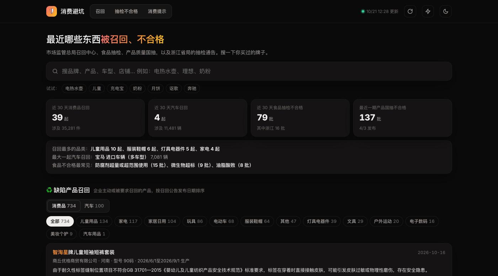
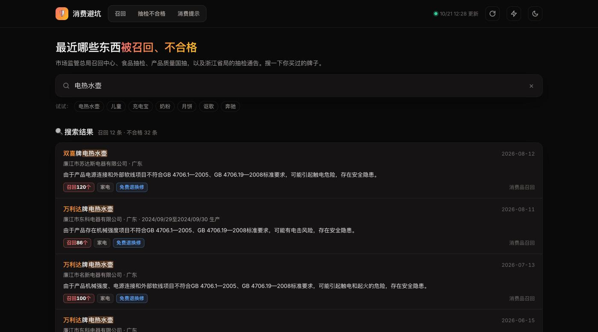

# 🛡 消费避坑

> 最近哪些东西被召回、抽检不合格？消费品召回、汽车召回、食品抽检、产品质量国抽，一页看完，按品牌搜一下

**🌐 在线访问：[https://climb0516.github.io/recall-watch/](https://climb0516.github.io/recall-watch/)**

---

## 截图

**概览 + 召回**：近 30 天召回、不合格数量，召回最多的品类，消费品 / 汽车召回列表



**搜索**：输入品牌、产品、车型、店铺，召回和不合格记录一起搜



---

## 功能

- **搜索**（首屏）：品牌、产品、车型、企业、店铺、型号、召回编号都能搜，空格分隔多个词表示同时满足，命中的词高亮
- **概览**：近 30 天消费品召回起数与件数、汽车召回起数与辆数、食品抽检不合格批次（含浙江）、最近一期产品国抽不合格批次；召回最多的品类、最大一起汽车召回、食品最常见的不合格原因
- **缺陷产品召回**
  - 消费品 / 汽车两个标签，消费品按品类筛选（儿童用品、家电、电子数码、灯具电器件、服装鞋帽、电动车、玩具等）
  - 每条写清品牌、产品、企业、省份、型号、生产日期范围、召回数量、缺陷和风险，是否免费退换修；汽车附召回编号和实施日期
- **抽检不合格**
  - 食品 / 产品两个标签；按「只看浙江」、电商平台（淘宝、拼多多、抖音、天猫、京东…）、品类筛选
  - 每条写清产品、商标、标称生产企业、销售店铺和平台、不合格项目、检出值与标准值，并把不合格项目翻成白话（例如「对触及带电部件的防护」→ 有触电风险，「菌落总数」→ 卫生没控制好）
  - 国抽里带 * 的安全项目单独标出
- **消费提示**：中国消费者协会最新消费警示
- 底部：各来源抓取状态和本次新增条数
- 右上角：↻ 重新读取数据，⚡ 跳转 GitHub Actions 手动触发抓取，☾ 深浅色；手机适配

---

## 数据来源

| 来源 | 内容 | 说明 |
|---|---|---|
| [市场监管总局缺陷产品召回中心 · 消费品召回](https://www.samrdprc.org.cn/xfpzh/index.html) | 品牌、产品、企业、省份、型号、数量、缺陷、处理方式 | 标题「【省份】X公司召回部分Y牌Z」，详情页正文解析 |
| [召回中心 · 汽车召回](https://www.samrdprc.org.cn/zhxx/jdczh/jdczh/index.html) | 车企、车型、召回编号、生产日期、辆数、缺陷 | 召回中心不通时改用[总局镜像栏目](https://www.samr.gov.cn/zw/zh/index.html) |
| [市场监管总局 · 食品抽检不合格通报](https://www.samr.gov.cn/zw/zfxxgk/fdzdgknr/spcjs/index.html) | 产品、**商标**、生产企业、被抽样单位、网店、规格、生产日期、不合格项目、检验值、标准值、食品细类 | 解析每期通报附带的 .xlsx（标准库 zipfile） |
| [浙江省市场监管局 · 食品抽检通告](https://zjamr.zj.gov.cn/col/col1228969898/index.html) | 产品、标称生产者、销售者、平台、不合格项目及类别 | 约每周一期，附件是老 .xls，改为解析正文逐条 |
| [市场监管总局 · 产品质量国家监督抽查](https://www.samr.gov.cn/zljds/jdcc/index.html) | 产品种类、产品名称、生产 / 受检单位、所在地、规格型号、不合格项目、电商平台 | 解析附件 1 的 .xlsx；一年只发几期，保留两年 |
| [中国消费者协会 · 消费警示提示](https://cca.org.cn/channel/list/11188.html) | 标题、日期、链接 | 静态列表页 |

**限制**：
- 国家药监局（药品、化妆品、医疗器械抽检）和海关总署（不合格进口食品）有瑞数反爬，抓不了
- 全国食品抽检结果查询系统要过滑块验证码，抓不了；浙江省局「不合格且逾期未改正企业」名单只在老 .xls 附件里，标准库解析不了
- 浙江食品通告正文没有商标，只能搜生产企业、销售者和产品名
- 品类按产品名关键词归类，少量会分错，归不进去的算「其他」
- 「不合格」只代表被抽检的那一批次，不代表该品牌所有产品都有问题

---

## 技术架构

```
GitHub Actions（每 6 小时 / 手动 / 修改爬虫后 push）
  ↓ python scraper.py（只用标准库）
  ↓ jpaas 栏目接口翻页（栏目页里取 queryData，再调 /api-gateway/jpaas-publish-server/front/page/build/unit）
  ↓ 增量：data.json 里已有的详情页 URL 不再请求；只翻到保留期（一年，国抽两年）为止
  ↓ 详情页正文正则解析 / xlsx 附件解析
  ↓ 写入 data.json 并 commit（updated 每次都变 = 心跳，防止定时任务因 60 天不活跃被停用）
       ↓
GitHub Pages（index.html 读取同目录 data.json，搜索、筛选、统计、白话解释都在前端完成）
```

部分站点只对国内解析域名，海外 Runner 的 DNS 查不到时，爬虫会改用阿里 DoH（带国内 EDNS 网段）解析，SNI 和 Host 仍是原域名。

### data.json 结构

```
{
  "updated": "2026-10-21T11:40:00+08:00",
  "keep_days": 365,
  "recalls": [ { "kind": "consumer", "date": "2026-10-16", "title": "...", "url": "...", "province": "河南",
                 "company": "...", "brand": "智淘星", "product": "儿童短袖短裤套装", "cat": "儿童用品",
                 "qty": "89", "unit": "套", "model": "90码", "produced": "...", "defect": "...", "remedy": "..." },
               { "kind": "auto", "brand": "讴歌", "product": "进口和国产讴歌", "qty": "4395", "unit": "辆",
                 "codes": ["E2026M0088V", "E2026M0089V"], "start": "2026年11月30日", ... } ],
  "fails":   [ { "kind": "food", "src": "总局", "date": "...", "notice": "...", "url": "...", "product": "...",
                 "brand": "爱尚圣菲", "maker": "...", "seller": "...", "platform": "淘宝", "shop": "...",
                 "items": "山梨酸及其钾盐", "value": "0.170g/kg", "std": "≤0.5g/kg", "group": "饮料", "cat": "饮料酒水", "region": "全国" },
               { "kind": "product", "src": "国抽", "group": "快热式电热水器", "items": "对触及带电部件的防护*", ... } ],
  "notices": [ { "date": "...", "title": "...", "url": "...", "src": "总局食品抽检", "count": 63 } ],   // 已处理过的通报，增量判断用
  "tips":    [ { "date": "2026-09-28", "title": "...", "url": "..." } ],
  "sources": [ { "id": "consumer_recall", "name": "消费品召回", "ok": true, "added": 3, "count": 812, "updated": "..." } ]
}
```

---

## 本地预览

```
python3 scraper.py
python3 -m http.server 8812
# 打开 http://localhost:8812
```

> 首次运行要抓近一年上千个详情页，每个请求间隔 0.4 秒，大约 15～25 分钟；之后每次只抓新增的。
