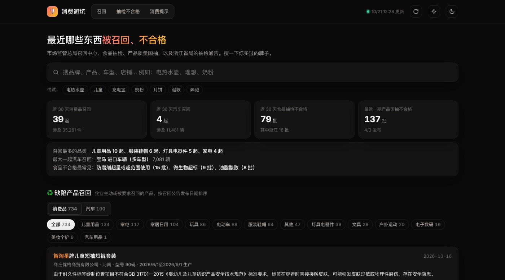
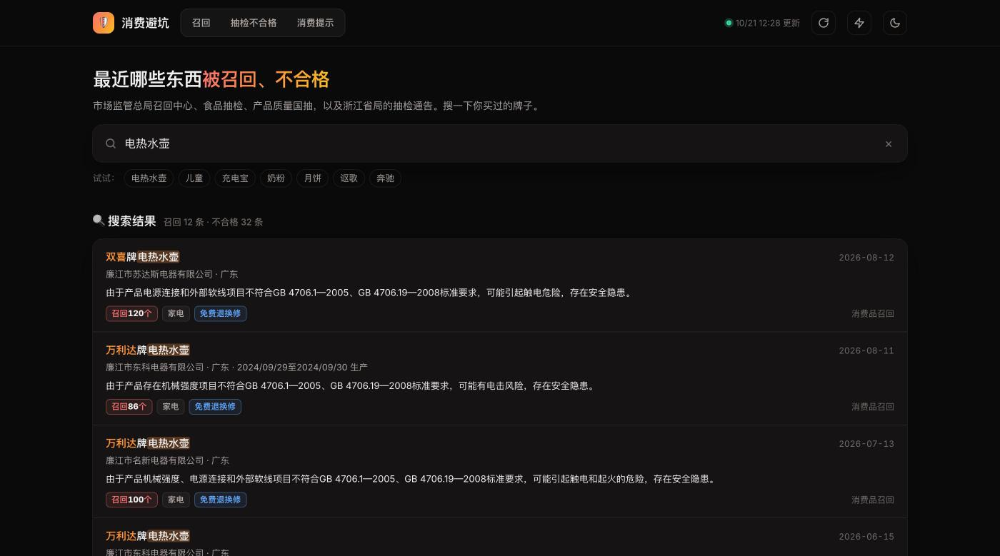

# 🛡 消费避坑

> 最近哪些东西被召回、抽检不合格？消费品召回、汽车召回、食品抽检、产品质量国抽，一页看完，按品牌搜一下

**🌐 在线访问：[https://climb0516.github.io/recall-watch/](https://climb0516.github.io/recall-watch/)**

---

## 截图

**概览 + 召回**：近 30 天召回、不合格数量，召回最多的品类，消费品 / 汽车召回列表



**搜索**：输入品牌、产品、车型、店铺，召回和不合格记录一起搜



---

## 功能

- **搜索**（首屏）：品牌、产品、车型、企业、店铺、型号、召回编号都能搜，空格分隔多个词表示同时满足，命中的词高亮
- **概览**：近 30 天消费品召回起数与件数、汽车召回起数与辆数、食品抽检不合格批次（含浙江）、最近一期产品国抽不合格批次；召回最多的品类、最大一起汽车召回、食品最常见的不合格原因
- **缺陷产品召回**
  - 消费品 / 汽车两个标签，消费品按品类筛选（儿童用品、家电、电子数码、灯具电器件、服装鞋帽、电动车、玩具等）
  - 每条写清品牌、产品、企业、省份、型号、生产日期范围、召回数量、缺陷和风险，是否免费退换修；汽车附召回编号和实施日期
- **抽检不合格**
  - 食品 / 产品两个标签；按「只看浙江」、电商平台（淘宝、拼多多、抖音、天猫、京东…）、品类筛选
  - 每条写清产品、商标、标称生产企业、销售店铺和平台、不合格项目、检出值与标准值，并把不合格项目翻成白话（例如「对触及带电部件的防护」→ 有触电风险，「菌落总数」→ 卫生没控制好）
  - 国抽里带 * 的安全项目单独标出
- **消费提示**：中国消费者协会最新消费警示
- 底部：各来源抓取状态和本次新增条数
- 右上角：↻ 重新读取数据，⚡ 跳转 GitHub Actions 手动触发抓取，☾ 深浅色；手机适配

---

## 技术架构

```
GitHub Actions（定时每 6 小时 / 手动 dispatch / push 修改 scraper.py 或 workflow）
  ↓ python scraper.py（Python 3.12，只用标准库，无第三方依赖）
  ↓ 读取旧 data.json → 按保留期裁剪 → 得到「已抓过的 URL」集合
  ↓ 6 个来源依次抓取
  ↓   · jpaas 栏目接口翻页取列表 → 只请求新详情页（每源每次最多 400 个）
  ↓   · 详情页正文正则解析 / .xlsx 附件解析 / 召回公告抓第一张产品或车辆照片
  ↓   · 中消协：静态列表页 2 页 + 正文和首图
  ↓ 补图（旧召回缺 img 字段的，每次补 300 条）→ 品类重算 → 按日期倒序
  ↓ 写入 data.json（updated 每次都变 = 心跳）
  ↓ git commit + pull --rebase + push
       ↓
GitHub Pages（index.html 读取同目录 data.json，cache: no-cache）
  ↓ 首页：概览统计 / 召回 / 抽检不合格 / 消费提示 / 来源状态，搜索、筛选、白话解释都在前端完成
  ↓ kit 详情抽屉 #/item/rc|fl|tip/<id>，列表页 #/list/recalls|fails|notice|tips
```

部分站点只对国内解析域名，海外 Runner 的系统 DNS 查不到时，`_getaddrinfo()` 会改问阿里 DoH（`dns.alidns.com`，带国内 EDNS 网段 `115.238.0.0/24`）拿 A 记录，只替换解析出的 IP，TLS 的 SNI 和 Host 仍是原域名。

---

## 数据来源

| 来源 | 方式 | 每次条数 / 范围 | 备注 |
|---|---|---|---|
| [缺陷产品召回中心 · 消费品召回](https://www.samrdprc.org.cn/xfpzh/index.html) | jpaas 列表接口 + 详情页网页解析 | 翻页到 365 天前为止（最多 60 页 × 20 条），新详情每次最多 400 个 | 标题需含「召回」；解析品牌、产品、企业、省份、型号、数量、缺陷、处理方式，抓正文第一张产品照片 |
| [召回中心 · 汽车召回](https://www.samrdprc.org.cn/zhxx/jdczh/jdczh/index.html) | 同上 | 同上 | 标题需含「召回」；召回中心整源失败时改抓[总局镜像栏目](https://www.samr.gov.cn/zw/zh/index.html)（来源名显示为「汽车召回（总局）」） |
| [市场监管总局 · 食品抽检不合格通报](https://www.samr.gov.cn/zw/zfxxgk/fdzdgknr/spcjs/index.html) | jpaas 列表接口 + 通报附件 .xlsx 解析（标准库 zipfile） | 365 天内、标题含「不合格」的通报；每期通报的全部不合格行 | 带**商标**、被抽样单位、网店、规格、生产日期、检验值、标准值；通报里没有 .xlsx 时退回正文逐条解析 |
| [浙江省市场监管局 · 食品抽检通告](https://zjamr.zj.gov.cn/col/col1228969898/index.html) | jpaas 列表接口 + 正文逐条网页解析 | 365 天内、标题含「抽检」的通告 | 附件是老 .xls 解析不了，改解析正文；正文没有商标 |
| [市场监管总局 · 产品质量国家监督抽查](https://www.samr.gov.cn/zljds/jdcc/index.html) | jpaas 列表接口 + 附件 .xlsx 解析 | 730 天内、标题含「国家监督抽查」的通报 | 只解析名字含「不合格产品」的附件；一年只发几期，保留两年 |
| [中国消费者协会 · 消费警示提示](https://cca.org.cn/channel/list/11188.html) | 静态列表页网页解析 | 列表前 2 页（`11188.html`、`11188_2.html`），当前数据 40 条 | 每条再抓正文（前 3000 字）和首图，按 URL 缓存，抓过的不再请求 |

**来源配置**：前 5 个来源在 `main()` 里各调用一次 `run(sid, name, base, column, parser, sink, count, title_ok, is_notice, keep_days)`，参数依次是来源 id、显示名、站点根地址、栏目页地址、详情解析函数、写入的数组（`recalls` / `fails`）、统计条数的条件、标题过滤、是否按「通报」处理（一篇通报展开成多条）、保留天数。中消协是单独的 `cca_tips()`。

**增加来源**：如果新栏目也是 jpaas CMS（栏目页里有 `queryData="…"`），写一个 `parse_xxx(date, title, url)` 返回单条 dict（或通报型返回 list），在 `main()` 里加一行 `run(...)` 即可；前端要在 `index.html` 的 `srcName()`、筛选（`flData()` / `rcData()`）里认得新的 `src` / `kind`。**删除来源**：注释掉对应的 `run(...)`，旧数据会随保留期自然过期。

**相关常量**（`scraper.py` 顶部）：

| 常量 | 值 | 含义 |
|---|---|---|
| `KEEP_DAYS` | 365 | 召回、食品抽检、通报的保留天数 |
| `KEEP_DAYS_GUOCHOU` | 730 | 国抽的保留天数 |
| `MAX_NEW_DETAILS` | 400 | 每个来源单次最多新抓的详情页，首轮分几次补齐 |
| `PAUSE` | 0.4 秒 | 列表翻页、详情页、附件请求之间的间隔 |
| `jpaas_list(size=20)` / `crawl_column(max_pages=60)` | 20 / 60 | 列表每页条数 / 最多翻页数 |
| `fetch_bytes(timeout=25, retries=2)` | 25 秒 / 2 次 | 单次请求超时与重试（重试间隔 2、5 秒） |

**限制**：
- 国家药监局（药品、化妆品、医疗器械抽检）和海关总署（不合格进口食品）有瑞数反爬，抓不了
- 全国食品抽检结果查询系统要过滑块验证码，抓不了；浙江省局「不合格且逾期未改正企业」名单只在老 .xls 附件里，标准库解析不了
- 浙江食品通告正文没有商标，只能搜生产企业、销售者和产品名
- 品类按产品名关键词归类，少量会分错，归不进去的算「其他」
- 「不合格」只代表被抽检的那一批次，不代表该品牌所有产品都有问题

---

## 数据处理规则

### 列表抓取与去重

- **jpaas 列表**（`jpaas_list()`）：栏目页是空壳，先从栏目页 HTML 取 `queryData="…"`（按栏目缓存），再带 `paramJson={"pageNo", "pageSize": 20}` 调 `/api-gateway/jpaas-publish-server/front/page/build/unit`，返回的 HTML 片段里找 `/art/` 链接。
  - 链接文字少于 8 个字的（「召回公告」「VIN码查询」这类附属短链接）跳过
  - 日期按「链接之后、下一个链接之前的第一个 `YYYY-MM-DD`」配对，兼容不同栏目模板
  - URL 去掉 `?type=` 后缀，同一页内按 URL 去重
- **翻页与增量**（`crawl_column()`）：一直翻到某页最后一条早于保留期为止（列表请求很轻），只留下 `日期 ≥ 截止日`、标题通过 `title_ok`、URL 不在 `known` 里的条目，截取前 `MAX_NEW_DETAILS`（400）个。被截掉的旧条目下次运行再补。
- **已抓集合** `known` = 保留期内所有召回的 `url` ∪ 所有已处理通报的 `url`（`notices` 里存着，包括解析出 0 条的通报，避免反复请求）。
- **容错**：单条详情解析失败只打印、跳过，下次还会再试；整个来源失败时 `sources[].ok=false`、`error` 记原因，该来源的旧数据照常保留，`updated` 沿用上次成功时间。

### 消费品召回（`parse_consumer_recall()`）

- **标题拆字段**：`【省份】X公司(扩大)召回(部分)Y牌Z(产品)` → `province`、`company`、`brand`、`product`。例：「【河南】某公司召回部分智淘星牌儿童短袖短裤套装」→ 品牌「智淘星」、产品「儿童短袖短裤套装」。
- **表格式公告**（页面里出现「生产者名称」时，`recall_table()`）：按 `TABLE_KEYS` 里的字段名（生产者名称、品牌、型号/规格、生产起止日期、涉及数量、存在的缺陷、可能导致的后果、具体召回措施等）把下面的行拼成值，优先用表格里的企业和品牌。
- **正文式公告**：
  - 数量：先找「涉及数量(为/共) N 单位」，再找「共计 N 件/台/个/套/只/双/辆/把/张/盒/箱/条/顶/副/组/片/支/瓶」；都没有时把分货号列出的「数量 60 双、……」求和
  - 型号：「（型号/规格：…）」，最多 120 字
  - 生产日期：「召回 YYYY年M月D日至YYYY年M月D日期间」
  - 缺陷：第一个含「本次召回范围内」「由于」「隐患」或同时含「可能」「风险」的句子，最多 300 字
  - 整改方式：第一个含「将免费」「将为」的句子，最多 200 字
- 正文从「日前」或含「召回计划」的那行开始（`article_body()`），去掉页头导航。

### 汽车召回（`parse_auto_recall()`）

- 企业：标题里「召回」之前的部分。
- 车型（`auto_product()`）：「X公司召回部分进口和国产讴歌汽车」→「讴歌（进口和国产）」；只写「进口汽车」这类没有车型的，记成「进口车辆（多车型）」。
- 品牌（`brand_of_car()`）：先在车型里、再在企业名里按 `CAR_BRANDS` 列表顺序找第一个命中；`CAR_ALIAS` 把 AMG → 奔驰、MINI → 宝马、Smart → smart。
- 召回编号：正文所有「召回编号 XXX」，最多保留 6 个；数量：所有「共计 N 辆」求和；实施日期：「自 YYYY年M月D日起」。

### 产品 / 车辆实物照片（`content_img()`）

- 召回公告详情页 HTML 里按顺序找 ``，取**第一张**同时满足以下条件的图片：
  - 路径含 `/cms_files/filemanager/` 且含 `/picture/`（召回中心 CMS 的上传目录，即公告里附的产品 / 车辆照片）
  - 不匹配 `IMG_SKIP`：`logo|icon|wx|weixin|qrcode|ewm|banner|share|gongan|jiucuo|dzjg|/blue`（排除站点 logo、二维码、分享按钮、公安备案、纠错、党政机关标识等）
- 相对路径按 `https://www.samrdprc.org.cn/` 补全成绝对地址，写进 `img`；找不到写空串 `""`。
- **补图**：`img` 字段是后加的，旧记录没有这个键。每次运行在 `main()` 末尾挑出缺 `img` 键的召回，最多 300 条重新请求详情页补上；没图的记成空串，下次不再重复请求。
- 当前数据：833 条召回里 268 条有图（消费品 168 / 733，汽车 100 / 100）。
- 消费提示的首图另由 `cca_article()` 取：正文区（`id="content"` 到 `<!--底部开始-->`）里第一张路径不含 `/template/`、且不匹配 `IMG_SKIP` 的图片。
- 抽检不合格记录**没有图片**，前端一律用品类图标。

### 食品抽检（总局：`parse_samr_food()`；浙江及总局兜底：`parse_food_text()`）

- 总局：只取链接文字含「不合格」的 `.xlsx` 附件；附件名去掉「附件N」「监督抽检不合格产品信息」后作为 `group`（食品大类，如「饮料」）。`xlsx_rows()` 用 zipfile 读 sharedStrings 和第一个 sheet，`table()` 找含「样品名称」的表头行，表头去空格。
- `col()` 按表头**包含**关系取值，值为 `/` 视为空；生产日期如果是 5 位 Excel 序列号，按 1899-12-30 起算转成日期（`excel_date()`）。
- 平台（`platform_of()`）：按 `PLATFORMS` 顺序在备注里找第一个平台名（淘宝闪购、淘宝、天猫、京东、拼多多、抖音、快手、美团、饿了么、小红书、唯品会、1688、苏宁、得物、微店、盒马、叮咚、朴朴、多多买菜、有赞、微信），「淘宝闪购」归为「淘宝」；店铺从备注「网店名称：…」截取。
- 浙江正文：标题行「一、xxx」作为 `group`；每段用 `ITEM_RE` 匹配「销售者（店铺）在平台销售的、标称 XX 生产的 产品，其中 XX 不符合…」，拆出销售者、店铺（去掉「店铺名为」）、平台、生产者、产品、不合格项目；同一行重复出现只算一次；含「复检维持」的记 `note`。

### 产品质量国抽（`parse_guochou()`）

- 只解析名字含「不合格产品」的 `.xlsx` 附件，表头找「产品名称」；`group` = 产品种类，`items` 取「主要不合格项目」或「不合格项目」（带 `*` 的是安全项目，前端单独打标签），`region` = 所在地（没有则「全国」），平台从「电商平台」或「备注」列识别。

### 分类

- 消费品 / 国抽用 `guess_cat()`：按 `CATS` 顺序正则匹配「产品名 + 标题」（国抽是「产品种类 + 产品名」），第一个命中即用：儿童用品 → 玩具 → 电动车 → 家电 → 汽车用品 → 电子数码 → 灯具电器件 → 美妆个护 → 服装鞋帽 → 家居日用 → 户外运动 → 文具，都不中为「其他」。例：「儿童短袖短裤套装」先命中「儿童」→ 儿童用品，而不是服装鞋帽。
- 食品用 `food_cat()`：按 `FOOD_CATS` 顺序匹配「group + 产品名」：餐饮自制 → 保健特膳 → 糕点零食 → 乳制品 → 饮料酒水 → 肉蛋水产 → 粮油调味 → 蔬菜水果，都不中为「其他食品」（顺序有讲究：先判自制餐饮、特膳、零食，再判宽泛的果蔬粮油）。
- 汽车召回的 `cat` 固定为「汽车」。
- **每次运行都重算**：消费品 `cat`、汽车 `product` / `brand`、不合格 `cat` 全部按最新关键词重新计算，调整关键词后旧数据也会跟着变。

### 保留期、排序与瘦身

- 召回、食品不合格保留 365 天；国抽和 `notices` 保留 730 天。
- 三个数组都按 `date` 倒序。
- 不合格记录的通报标题 `notice` 在写盘前删掉，只在 `notices` 里按 URL 存一份，前端用 URL 反查标题。
- `data.json` 用紧凑 JSON（`separators=(",", ":")`）写出。

---

## 数据结构

`data.json` 顶层：

```
{
  "updated":   "2026-10-22T12:52:52+08:00",   // 本次运行时间（北京时间），每次都变 = 心跳
  "keep_days": 365,
  "recalls":   [ ... ],   // 召回，消费品 + 汽车
  "fails":     [ ... ],   // 抽检不合格，食品 + 国抽
  "notices":   [ ... ],   // 已处理过的通报（增量判断 + 前端反查通报标题）
  "tips":      [ ... ],   // 中消协消费提示
  "sources":   [ ... ]    // 各来源抓取状态
}
```

单条结构：

```
recalls（消费品）
{ "kind": "consumer", "date": "2026-10-16", "title": "【河南】…召回部分智淘星牌儿童短袖短裤套装", "url": "https://www.samrdprc.org.cn/…/art_xxx.html",
  "img": "https://www.samrdprc.org.cn/cms_files/filemanager/…/picture/…jpg",   // 没图为 ""
  "province": "河南", "company": "…", "brand": "智淘星", "product": "儿童短袖短裤套装", "cat": "儿童用品",
  "qty": "89", "unit": "套", "model": "90码", "produced": "2025年…至2026年…", "defect": "…", "remedy": "…" }

recalls（汽车）
{ "kind": "auto", "date": "…", "title": "…", "url": "…", "img": "…", "company": "…", "brand": "讴歌", "product": "讴歌（进口和国产）",
  "cat": "汽车", "qty": "4395", "unit": "辆", "codes": ["E2026M0088V", "E2026M0089V"], "start": "2026年11月30日", "defect": "…", "remedy": "…" }

fails（总局食品，xlsx）
{ "kind": "food", "src": "总局", "date": "…", "url": "通报详情页", "product": "…", "brand": "爱尚圣菲", "maker": "…", "seller": "…",
  "platform": "淘宝", "shop": "…", "spec": "…", "produced": "…", "items": "山梨酸及其钾盐", "value": "0.170g/kg", "std": "≤0.5g/kg",
  "group": "饮料", "cat": "饮料酒水", "region": "全国" }

fails（浙江食品，正文）
{ "kind": "food", "src": "浙江", "date": "2026-10-14", "url": "…", "product": "混合坚果A", "brand": "", "maker": "…", "seller": "…",
  "platform": "天猫", "shop": "", "items": "霉菌", "group": "微生物污染", "cat": "糕点零食", "region": "浙江", "note": "" }   // note 可能为「复检维持」

fails（国抽）
{ "kind": "product", "src": "国抽", "date": "…", "url": "…", "product": "…", "brand": "…", "maker": "…", "seller": "…", "platform": "…",
  "spec": "…", "produced": "…", "items": "对触及带电部件的防护*", "group": "快热式电热水器", "cat": "家电", "region": "所在地或「全国」" }

notices
{ "date": "…", "title": "…", "url": "…", "src": "总局食品抽检", "count": 63 }   // src 为来源显示名，count 为该通报解析出的条数（可为 0）

tips
{ "date": "2026-09-28", "title": "…", "url": "https://cca.org.cn/single/11188/70080.html", "body": "正文，最多 3000 字", "img": "首图或空串" }

sources
{ "id": "consumer_recall", "name": "消费品召回", "ok": true, "added": 3, "count": 733, "error": null, "updated": "…" }
```

`sources[].id` 取值：`consumer_recall`、`auto_recall`、`samr_food`、`zj_food`、`guochou`、`cca`。`added` 对通报型来源是新增的不合格条数，对中消协固定为 0。

当前数据量（2026-10-22 那次运行）：召回 833（消费品 733 / 汽车 100），不合格 1687（总局 1070 / 浙江 480 / 国抽 137），通报 69，提示 40。

项目没有其他 json、快照或图片目录：图片全部是外链（召回中心 / 中消协原站地址），不落盘；截图只有 `screenshot-recalls.jpg`、`screenshot-search.jpg`。

---

## 前端

单文件 `index.html`，数据只有同目录的 `data.json`（`fetch('data.json', { cache: 'no-cache' })`，每次向服务器校验；失败时保留已有内容）。

### 详情抽屉 + 列表页（kit 组件）

- 电脑端从右侧滑出，手机端从底部升起（高 86vh）；`Esc`、点遮罩、✕ 关闭。
- 打开详情会写进地址 `#/item/<类型>/<id>`，可以直接分享，打开分享链接会在数据读完后（`KIT.boot()`）自动弹出；浏览器返回 = 关闭。
- 条目已不在当前数据里（已下榜 / 过期 / 旧链接）时弹提示「这条内容已不在当前数据里」，并给「回到首页」按钮。

本项目的条目类型：

| 类型 | 地址 | id 取法 | 详情内容 |
|---|---|---|---|
| `rc` 召回 | `#/item/rc/<id>` | 公告 URL 里 `art_` 后面的编号（取不到用 `i` + 下标） | 照片封面、召回数量、召回信息键值格、缺陷、整改方式、同品牌 / 企业的其它召回、同品类的其它召回、「阅读召回公告」 |
| `fl` 不合格 | `#/item/fl/<id>` | `fails` 数组下标 | 不合格项目（大字）、实测值 / 标准值、白话解释、产品信息、所在通报、同一通报其它不合格产品、「查看通报原文」 |
| `tip` 消费提示 | `#/item/tip/<id>` | URL 末尾的数字 | 首图、正文、其它消费提示、「阅读原文」 |

注意：`fl` 的 id 是数组下标，数据更新后旧分享链接可能指向另一条记录或已不存在。

本项目的列表页 key（每页 30 条，「加载更多」）：

| key | 地址 | 参数 |
|---|---|---|
| `recalls` | `#/list/recalls?kind=&cat=&sort=` | `kind` = `consumer` / `auto`；`cat` = 品类；`sort` = `date`（默认）/ `qty`（按召回数量） |
| `fails` | `#/list/fails?kind=&f=` | `kind` = `food` / `product`；`f` = `all` / `zj`（只看浙江）/ `p:平台` / `c:品类` |
| `notice` | `#/list/notice/<下标>` | 某一期通报的全部不合格产品 |
| `tips` | `#/list/tips` | 全部消费提示 |

### 图片与品类图标占位

- 召回卡片：有 `img` 时卡片带 `has-img`，左侧显示产品 / 车辆照片（`background-image`）；没有时带 `has-ic`，显示 `icBlock(cat)`：品类 emoji + 品类色块。
- 品类图标 `CAT_ICON`：儿童用品 🧸、玩具 🪀、家电 🔌、家居日用 🏠、服装鞋帽 👕、电动车 🛵、灯具电器件 💡、文具 ✏️、户外运动 🚴、电子数码 📱、美妆个护 🧴、汽车用品 / 汽车 🚗；食品：粮油调味 🧂、糕点零食 🍪、蔬菜水果 🥬、饮料酒水 🥤、保健特膳 💊、其他食品 🍽、肉蛋水产 🥩、餐饮自制 🍜、乳制品 🥛；未列出的品类用 📦。
- 品类色 `CAT_C` 复用站点语义色（`--warn` / `--info` / `--good` / `--accent` / `--bad`），未列出的用 `--text-3`。
- 详情抽屉：召回有图时用照片做高封面（`coverTall`），无图时标题左侧显示品类图标（背景为品类色 18% 混合）；不合格记录始终用品类图标；消费提示有首图用首图，否则用 📢。
- 详情里的「其它召回」列表行有图时带缩略图。

### 其他前端功能

- **搜索**（`renderSearch()`）：把标题、品牌、产品、企业、型号、生产者、销售者、店铺、平台、不合格项目、品类、分组、省份、地区、缺陷、召回编号拼成一段小写文本，空格分隔的每个词都要命中；命中词用 `<mark>` 高亮；召回和不合格合并按日期倒序，每次显示 30 条，可加载更多；输入防抖 150 ms。
- **白话解释**（`PLAIN`）：不合格项目按正则命中第一条翻成白话，例如黄曲霉 → 强致癌物、菌落总数 / 大肠菌群等 → 微生物超标、标识 / 说明 → 标识或说明不规范；概览里「食品最常见的不合格原因」也按这个归类计数。
- **概览**（`renderStats()`）：近 30 天（北京时间）消费品召回起数与件数、汽车召回起数与辆数、食品不合格批次（含浙江）、最近一期国抽不合格批次；召回最多的 4 个品类、最大一起汽车召回、前 3 个不合格原因。
- **首页列表**：召回、不合格各显示 10 条，其余点「查看全部」进列表页；平台筛选只列条数前 7 的平台。
- **来源状态**：底部按 `sources` 显示每个来源条数 / 新增数，失败的显示「失败，沿用旧数据」；顶部更新时间旁标出异常来源个数。
- **本地记忆**（localStorage，前缀 `rw:`）：召回 / 不合格当前标签、深浅色主题。
- 右上角 ↻ 重新读取 `data.json`，⚡ 跳转 GitHub Actions 页面手动触发，☾ 切换深浅色。

---

## 本地运行

```
python3 scraper.py
python3 -m http.server 8812
# 打开 http://localhost:8812
```

- 依赖：Python 3（Actions 用 3.12），只用标准库，不用 `pip install`。
- 环境变量：无，不需要任何密钥。
- 每个来源单次最多新抓 400 个详情页，请求间隔 0.4 秒；首次从空数据开始要分几次运行才能补齐一年数据，单次运行耗时未确认（Actions 设置的超时为 60 分钟）。之后每次只抓新增的。
- 部分政府站点在海外网络下可能解析或握手失败，失败的来源会沿用旧数据，见页面底部来源状态。

---

## 自动更新机制

| 触发方式 | 时机 |
|---|---|
| GitHub Actions 定时任务 | cron `41 */6 * * *`（UTC），即每天北京时间 02:41、08:41、14:41、20:41 |
| push 到 main 且改动了 `scraper.py` 或 `.github/workflows/scrape.yml` | 推送后立即运行 |
| GitHub Actions 手动 dispatch | 按需触发（页面右上角 ⚡ 直达） |

- workflow 名为「Recall Watch Scraper」，`concurrency: scrape` 且不取消进行中的任务，同一时间只跑一个；超时 60 分钟。
- 运行后只 `git add data.json`，有变化才 commit（提交信息 `data: update <北京时间>`），再 `git pull --rebase` 后 push。
- **心跳**：`data.json` 的 `updated` 字段每次运行都会变，所以每次都会产生提交，仓库保持活跃。GitHub 会在仓库 60 天无提交时自动停用定时任务；如果抓取连续失败到不再提交，需在 Actions 页面重新启用。
